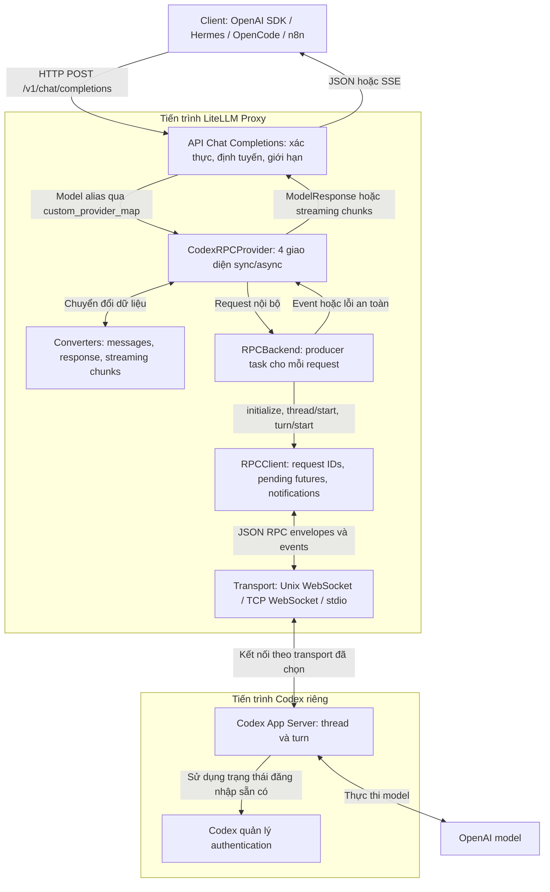
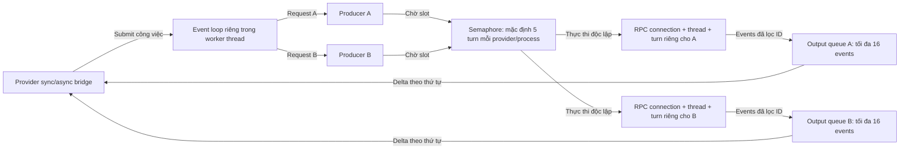
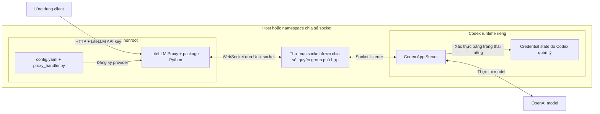

# Kiến trúc xử lý và tích hợp

Mô hình đối chiếu với implementation tại commit `7fbf49d`. LiteLLM cung cấp API tương
thích OpenAI; package chuyển request sang Codex RPC; Codex App Server là tiến trình
thực thi và quản lý xác thực riêng. Các phần chưa triển khai không được vẽ như thành
phần đang hoạt động.

## 1. Kiến trúc tổng thể



Ranh giới xác thực: API key của LiteLLM bảo vệ endpoint của Proxy. Trạng thái đăng
nhập Codex chỉ thuộc runtime Codex; plugin không đọc `auth.json` và không refresh OAuth.
Nếu dùng WebSocket từ xa, token truy cập server là một lớp xác thực riêng.

## 2. Luồng một request

```mermaid
sequenceDiagram
    autonumber
    participant C as Client
    participant L as LiteLLM Proxy
    participant P as Provider / Converters
    participant B as Backend / Producer
    participant R as RPCClient / Transport
    participant S as Codex App Server
    C->>L: POST chat/completions + model alias + messages
    L->>L: Xác thực API key và chọn provider
    L->>P: completion hoặc streaming, sync/async
    P->>P: Kiểm tra alias, tham số, nội dung
    P->>B: Submit lên event loop riêng của provider
    B->>B: Bắt đầu deadline; chờ semaphore
    B->>R: Mở kết nối mới cho request
    R->>S: initialize
    S-->>R: result
    R->>S: initialized notification
    B->>R: account/read, refreshToken=false
    R->>S: account/read
    S-->>R: Trạng thái account
    B->>R: thread/start, ephemeral=true
    R->>S: thread/start, read-only, untrusted approvals
    S-->>R: thread.id
    B->>R: turn/start với text và threadId
    R->>S: turn/start
    S-->>R: turn.id
    loop Nhận từng phần nội dung
        S-->>R: item/agentMessage/delta
        R-->>B: Notification qua queue tối đa 64 events
        B->>B: Lọc threadId/turnId; queue đầu ra tối đa 16 events
        alt stream=true
            B-->>P: Event chứa delta
            P-->>L: GenericStreamingChunk
            L-->>C: SSE chunk
        else stream=false
            B->>B: Tích lũy text cho response cuối
        end
    end
    S-->>R: turn/completed + terminal status
    R-->>B: Terminal notification
    alt status=completed
        B-->>P: Event done hoặc kết quả đã tích lũy
        P-->>L: Chunk kết thúc hoặc ModelResponse
        L-->>C: SSE kết thúc hoặc JSON completion
    else status=failed hoặc interrupted
        B-->>P: ProviderError an toàn
        P-->>L: Lỗi có phân loại
        L-->>C: Lỗi; không báo thành công giả
    end
    B->>R: Đóng kết nối và giải phóng tài nguyên
```

Nhánh lỗi có thể xảy ra ở mọi bước, kể cả trước `thread/start`. `account/read` xác nhận
trạng thái account do server báo; không đảm bảo model thực thi thành công.

Mỗi request tạo kết nối và thread mới. Không có connection pool hay tái sử dụng thread
trong implementation hiện tại. Hai request có cùng nội dung vẫn độc lập.

## 3. Concurrency, streaming và cancellation



Producer là task sống xuyên suốt request, giữ deadline có hiệu lực sau mỗi lần yield.
Deadline bao gồm chờ semaphore, kết nối, handshake, thực thi và chờ consumer khi queue
đầu ra đầy. Queue RPC đầy gây lỗi backpressure rõ ràng; queue đầu ra đầy sẽ chặn producer
cho đến khi có chỗ hoặc deadline hết hạn.

| Tình huống | Hành vi hiện tại |
|---|---|
| Client hủy, đóng stream hoặc shutdown | Hủy producer; thử `turn/interrupt` nếu đã biết threadId và turnId; đóng connection |
| Timeout | Lỗi timeout; thử interrupt tối đa 2 giây; cleanup có thể kéo dài thêm thời gian phản hồi |
| Server mất kết nối | Giữ các event đã nhận; trả lỗi nếu chưa nhận terminal hợp lệ |
| Request mới sau disconnect | Tạo kết nối mới nếu auto reconnect bật; không replay request cũ |
| Server yêu cầu approval/interactive action | Trả RPC error -32601 và lỗi controlled cho request; không approve |
| Đóng provider | Ngắt producer trước, đóng connection rồi dừng event loop; muốn dùng lại phải tạo instance mới |

`turn/interrupt` là best effort; việc mất kết nối không chứng minh model đã dừng phía server.
Giới hạn 5 là theo provider/process. Nếu có 3 worker độc lập, không được coi đây là giới hạn
tổng 5 cho toàn bộ deployment. Cần giới hạn chung ở tầng routing hoặc hạ tầng nếu có yêu cầu đó.

## 4. Mô hình triển khai Docker qua Unix socket



Compose hiện chỉ khởi chạy Proxy; người vận hành phải chạy Codex App Server riêng.
`CODEX_SOCKET_DIR` cung cấp thư mục socket được bind mount vào `/run/codex`, còn
`CODEX_SOCKET_GID` cấp quyền truy cập cho user nonroot. Không mount credential state
của Codex vào Proxy. Port Proxy được bind vào `127.0.0.1:4000` trong cấu hình mẫu.
Mount read-only không làm các lệnh RPC thành read-only; runtime Codex vẫn cần được cô lập.

## 5. Điểm tích hợp và mapping

| Thành phần | File chính | Trách nhiệm |
|---|---|---|
| Proxy routing | config.example.yaml | Alias `codex-default` → `codex_rpc/codex-default`; tắt router retries |
| Import shim | proxy_handler.py | Loader LiteLLM 1.80.7 tìm file cạnh YAML, rồi import package đã cài |
| Provider | src/litellm_codex_rpc/provider.py | completion, acompletion, streaming, astreaming; cầu nối sync/async |
| Configuration | src/litellm_codex_rpc/config.py | Kiểm tra cấu hình transport, timeout, aliases và chế độ hỗ trợ |
| Converters | src/litellm_codex_rpc/converters/ | Chuyển messages → text; Event → ModelResponse hoặc chunks |
| Backend | src/litellm_codex_rpc/backends/rpc_backend.py | Điều phối request, producer, concurrency và vòng đời thread/turn |
| RPC client | src/litellm_codex_rpc/rpc/client.py | Pending futures theo RPC request ID; phân phối notifications; lỗi protocol |
| Transports | src/litellm_codex_rpc/transport/ | Unix WebSocket, TCP WebSocket và subprocess stdio tùy chọn |
| Errors | src/litellm_codex_rpc/errors.py | Lỗi an toàn cho client, không phản chiếu message nhạy cảm từ server |

Có hai lớp mapping model: LiteLLM chọn provider bằng prefix `codex_rpc/`; sau đó
`CODEX_MODEL_MAP` ánh xạ alias trong provider sang model Codex. Giá trị `null` dùng
model mặc định của Codex server, không tự suy luận quyền sử dụng model của account.

## 6. Giới hạn của mô hình hiện tại

- Backend RPC là implementation duy nhất; legacy direct chưa có do licensing upstream.
- Chỉ stateless. Mặc định một user text message; history/system/developer yêu cầu opt-in
  flattening thành JSON text, không có ngữ nghĩa role tương đương tuyệt đối.
- Client-owned tools, multimodal, stateful sessions và các tham số chưa hỗ trợ bị từ chối.
- Agent mode không được bật. Read-only sandbox và feature flags chưa phải bảo đảm mọi
  công cụ nội bộ đều bị vô hiệu; cần Codex service riêng với cô lập OS/container phù hợp.
- Đã có 39 tests và kiểm chứng Docker/Proxy với server giả lập. Handshake với Codex thật
  đã thành công; một text turn hoàn chỉnh từ Codex thật vẫn chưa được xác nhận.
